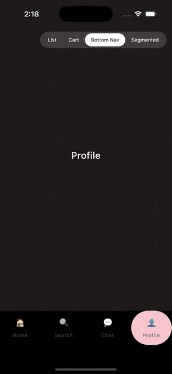

# Bottom Navigation Indicator

=== "Android"
    

=== "iOS"
    

A liquid pill that bridges between bottom-nav items as the selection changes.

```kotlin
val state = rememberGooeyNavIndicatorState(selectedIndex = 0)

GooeyNavIndicatorHost(state = state, color = Mint) {
    NavigationBar {
        tabs.forEachIndexed { index, tab ->
            NavigationBarItem(
                modifier = Modifier.gooeyNavItem(state, index),
                selected = state.selectedIndex == index,
                onClick = { state.select(index) },
                icon = { /* ... */ },
            )
        }
    }
}
```
