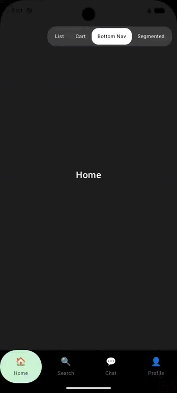
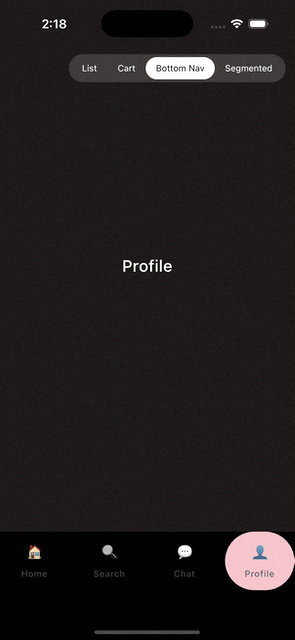

# Bottom Navigation Indicator

=== "Android"
    

=== "iOS"
    

A liquid pill that bridges between bottom-nav items as the selection changes. It wraps any
`NavigationBar` (or your own row of tabs) — you only add one `Modifier` and one state object.

## Quick start

This snippet is self-contained; paste it into a `@Composable` screen and it runs as-is.

```kotlin
import androidx.compose.foundation.layout.fillMaxWidth
import androidx.compose.material3.NavigationBar
import androidx.compose.material3.NavigationBarItem
import androidx.compose.material3.NavigationBarItemDefaults
import androidx.compose.material3.Text
import androidx.compose.ui.graphics.Color
import com.veroanggra.reactify.navbar.GooeyNavIndicatorHost
import com.veroanggra.reactify.navbar.gooeyNavItem
import com.veroanggra.reactify.navbar.rememberGooeyNavIndicatorState

private data class Tab(val label: String, val color: Color)

private val tabs = listOf(
    Tab("Home", Color(0xFFC8F5D4)),
    Tab("Search", Color(0xFFC4E4F7)),
    Tab("Chat", Color(0xFFFFF1B8)),
    Tab("Profile", Color(0xFFF6C6CC)),
)

@Composable
fun MyBottomNav() {
    val state = rememberGooeyNavIndicatorState(selectedIndex = 0)

    GooeyNavIndicatorHost(
        state = state,
        color = tabs[state.selectedIndex].color,
        modifier = Modifier.fillMaxWidth(),
    ) {
        NavigationBar {
            tabs.forEachIndexed { index, tab ->
                NavigationBarItem(
                    modifier = Modifier.gooeyNavItem(state, index),
                    selected = state.selectedIndex == index,
                    onClick = { state.select(index) },
                    icon = { /* see "Changing the icons" below */ },
                    label = { Text(tab.label) },
                    colors = NavigationBarItemDefaults.colors(indicatorColor = Color.Transparent),
                )
            }
        }
    }
}
```

Three moving parts, always used together:

1. `rememberGooeyNavIndicatorState(selectedIndex)` — one state object per nav bar.
2. `Modifier.gooeyNavItem(state, index)` — on every item, so the state knows where it sits.
3. `GooeyNavIndicatorHost(state, color) { ... }` — wraps the nav bar and draws the pill behind it.

Setting `indicatorColor = Color.Transparent` on `NavigationBarItemDefaults.colors(...)` is
important: it stops Material's own pill from drawing on top of the gooey one.

## How the state works

If you're new to this kind of "shared animated state" pattern, here's what happens under the hood:

1. **`rememberGooeyNavIndicatorState`** creates a `GooeyNavIndicatorState` and remembers it across
   recompositions. It does *not* track selection by itself — it only reacts when you tell it to.
2. Each item's **`Modifier.gooeyNavItem(state, index)`** reports that item's on-screen position and
   size back to the state the moment it's laid out (via `onGloballyPositioned`). This is how the
   state knows where tab 0, 1, 2... actually are, without you hardcoding any coordinates.
3. Nothing is drawn until at least one item has reported its bounds — so don't worry if the pill
   is invisible for a single frame on first composition; that's expected and happens before the
   user can see it.
4. **You** call `state.select(index)` from each item's `onClick`. The host never selects on its
   own — this keeps `GooeyNavIndicatorState` a plain source of truth you can also drive from
   elsewhere (e.g. a ViewModel-driven `LaunchedEffect`).
5. `select(index)` snapshots wherever the pill currently is (even mid-animation, if you tap twice
   quickly) as the animation's starting point, then animates to the new item's bounds using
   `animationSpec`. This is why rapid taps feel fluid instead of janky or queued.
6. `GooeyNavIndicatorHost` reads `state.selectedIndex` and the live animation progress every frame
   to build the blob shapes, and draws them on a `Canvas` placed *behind* your `content` (the real
   `NavigationBar`), which is why your icons and ripples still render normally on top.

In short: **the state is just data + an animation; your UI decides when `select()` is called.**
That also means you can trigger a selection change from anywhere you have a reference to `state`,
not only from inside the nav bar — useful for things like deep links or a "jump to tab" button.

## Customizing the color

`color` is a plain `androidx.compose.ui.graphics.Color` — there's no special color API to learn.

```kotlin
// A fixed brand color
GooeyNavIndicatorHost(state = state, color = Color(0xFF6750A4)) { /* ... */ }

// Wired to your Material theme
GooeyNavIndicatorHost(state = state, color = MaterialTheme.colorScheme.primary) { /* ... */ }

// A different color per tab, swapping as selection changes (as in the Quick start above)
GooeyNavIndicatorHost(state = state, color = tabs[state.selectedIndex].color) { /* ... */ }
```

Because `color` is read on every frame the scene is built, passing an expression like
`tabs[state.selectedIndex].color` is enough to get the pill to recolor itself as it slides — no
extra animation code needed. If you want the color itself to *crossfade* (rather than snap) while
the pill moves, animate it yourself and pass the animated value in:

```kotlin
val animatedColor by animateColorAsState(tabs[state.selectedIndex].color)
GooeyNavIndicatorHost(state = state, color = animatedColor) { /* ... */ }
```

## Changing the icons

There's no dedicated "icon" parameter — `icon` is just the normal `@Composable` content slot that
`NavigationBarItem` already exposes, so anything you'd normally put there works, including
swapping the icon per selection state:

```kotlin
import androidx.compose.material.icons.Icons
import androidx.compose.material.icons.filled.Home
import androidx.compose.material.icons.outlined.Home
import androidx.compose.material3.Icon

NavigationBarItem(
    modifier = Modifier.gooeyNavItem(state, index),
    selected = state.selectedIndex == index,
    onClick = { state.select(index) },
    icon = {
        val selected = state.selectedIndex == index
        Icon(
            imageVector = if (selected) Icons.Filled.Home else Icons.Outlined.Home,
            contentDescription = tab.label,
        )
    },
    label = { Text(tab.label) },
)
```

Reactify doesn't ship an icon set itself, so add one to your own app module (not the `reactify`
dependency) if you don't already have vector icons:

```kotlin
// Compose Multiplatform (Android + iOS)
commonMain.dependencies {
    implementation("org.jetbrains.compose.material:material-icons-extended:<compose-version>")
}
```

```kotlin
// Android-only app
implementation("androidx.compose.material:material-icons-extended")
```

Emoji `Text`, your own vector drawables, or an `Image` with a bitmap/SVG painter all work just as
well — the gooey pill only cares about the *bounds* reported by `gooeyNavItem`, not what's drawn
inside them.

## Parameters reference

**`rememberGooeyNavIndicatorState`**

| Parameter | Default | Description |
| --- | --- | --- |
| `selectedIndex` | — | Index selected the first time this state is created. Changing it on a later recomposition has no effect — use `state.select(index)` instead. |
| `animationSpec` | `tween(450ms, LinearEasing)` | Drives the transition progress (0→1) each time `select` is called. |

**`GooeyNavIndicatorHost`**

| Parameter | Default | Description |
| --- | --- | --- |
| `state` | — | The `GooeyNavIndicatorState` created above. |
| `color` | — | Fill color of the pill. Any `Color`, static or computed. |
| `cornerRadius` | `null` | Corner radius of the pill. `null` draws a stadium shape (half the item's height) — the right choice for most pill-shaped indicators. |
| `smoothness` | `18.dp` | How far the gooey blend reaches; higher values make the bridge between old and new position wider/softer. |
| `renderer` | `GooeyRenderers.auto()` | See [Choosing a Renderer](renderers.md). |

**`Modifier.gooeyNavItem(state, index)`** — no parameters beyond the state/index; apply it to the
same composable that receives `selected`/`onClick` (e.g. `NavigationBarItem`).

## Tips & troubleshooting

!!! tip "The pill doesn't show up at all"
    Make sure every tab has `Modifier.gooeyNavItem(state, index)` applied, and that `index` matches
    the `selectedIndex` you pass to `rememberGooeyNavIndicatorState`. The pill stays invisible until
    the item at the *initial* `selectedIndex` has reported its bounds at least once.

!!! tip "Selecting a tab doesn't move the pill"
    `state.select(index)` must be called from `onClick` yourself — the host doesn't observe
    `selected` on `NavigationBarItem`. If you drive selection from elsewhere (e.g. a shared
    `NavController`), call `state.select(index)` wherever that selection changes.

!!! tip "There's a double pill"
    Pass `indicatorColor = Color.Transparent` to `NavigationBarItemDefaults.colors(...)` so
    Material's built-in selection pill doesn't draw underneath yours.
