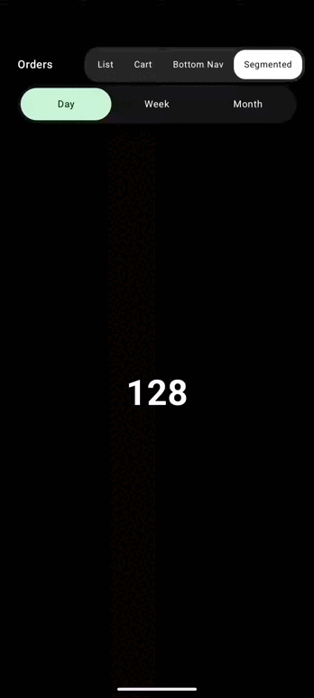
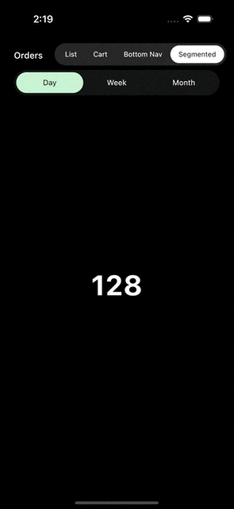

# Segmented Control

=== "Android"
    

=== "iOS"
    

The same liquid pill, bridging between segmented control options as the selection changes.

```kotlin
val state = rememberGooeySegmentedControlState(selectedIndex = 0)

GooeySegmentedControlHost(state = state, color = Mint) {
    Row {
        options.forEachIndexed { index, label ->
            Box(
                Modifier
                    .gooeySegmentItem(state, index)
                    .clickable { state.select(index) },
            ) { Text(label) }
        }
    }
}
```
