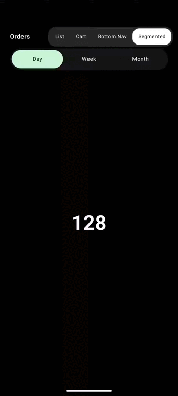
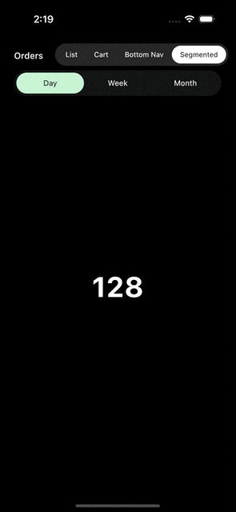

# Segmented Control

=== "Android"
    

=== "iOS"
    

The same liquid pill as the [bottom nav indicator](nav-indicator.md), bridging between segmented
control options as the selection changes. Use it for things like a day/week/month switcher or a
filter row.

## Quick start

This snippet is self-contained; paste it into a `@Composable` screen and it runs as-is.

```kotlin
import androidx.compose.foundation.background
import androidx.compose.foundation.clickable
import androidx.compose.foundation.layout.Row
import androidx.compose.foundation.layout.fillMaxWidth
import androidx.compose.foundation.layout.padding
import androidx.compose.foundation.shape.RoundedCornerShape
import androidx.compose.material3.Text
import androidx.compose.ui.Alignment
import androidx.compose.ui.Modifier
import androidx.compose.ui.draw.clip
import androidx.compose.ui.graphics.Color
import com.veroanggra.reactify.segment.GooeySegmentedControlHost
import com.veroanggra.reactify.segment.gooeySegmentItem
import com.veroanggra.reactify.segment.rememberGooeySegmentedControlState

private val options = listOf("Day", "Week", "Month")
private val Mint = Color(0xFFC8F5D4)

@Composable
fun MySegmentedControl() {
    val state = rememberGooeySegmentedControlState(selectedIndex = 0)

    GooeySegmentedControlHost(
        state = state,
        color = Mint,
        modifier = Modifier
            .fillMaxWidth()
            .background(Color.White.copy(alpha = 0.08f), RoundedCornerShape(percent = 50))
            .padding(4.dp),
    ) {
        Row(Modifier.fillMaxWidth()) {
            options.forEachIndexed { index, label ->
                val selected = state.selectedIndex == index
                Box(
                    Modifier
                        .weight(1f)
                        .gooeySegmentItem(state, index)
                        .clip(RoundedCornerShape(percent = 50))
                        .clickable { state.select(index) }
                        .padding(vertical = 10.dp),
                    contentAlignment = Alignment.Center,
                ) {
                    Text(label, color = if (selected) Color.Black else Color.White)
                }
            }
        }
    }
}
```

Three moving parts, always used together:

1. `rememberGooeySegmentedControlState(selectedIndex)` — one state object per control.
2. `Modifier.gooeySegmentItem(state, index)` — on every option, so the state knows where it sits.
3. `GooeySegmentedControlHost(state, color) { ... }` — wraps the row and draws the thumb behind it.

The `Modifier.background(...)` on the host (the rounded, semi-transparent track above) is
optional — it's what draws the pill-shaped groove the thumb slides inside.

## How the state works

This follows the exact same pattern as the [nav indicator](nav-indicator.md#how-the-state-works);
if you've already read that page, skip ahead.

1. **`rememberGooeySegmentedControlState`** creates a `GooeySegmentedControlState` and remembers it
   across recompositions. It only changes selection when you explicitly ask it to.
2. Each option's **`Modifier.gooeySegmentItem(state, index)`** reports that option's live
   on-screen bounds back to the state via `onGloballyPositioned`, so the thumb always knows exactly
   where to animate to or from — including after layout changes like text reflow or window resize.
3. Nothing is drawn until the option at the initial `selectedIndex` has reported its bounds once.
4. **You** call `state.select(index)` from each option's `onClick` — the host never infers
   selection on its own. This keeps the state a plain, independently drivable source of truth.
5. `select(index)` captures the thumb's current position (even mid-flight, if you tap again before
   the previous animation finished) and animates from there to the new option using
   `animationSpec`, so back-to-back taps feel continuous rather than queued.
6. The host reads `state.selectedIndex` and the animation progress every frame to build the blob
   shapes and draws them on a `Canvas` behind your `content`, so your labels/icons and click
   ripples still render normally on top.

## Customizing the color

`color` is a plain `androidx.compose.ui.graphics.Color`:

```kotlin
// A fixed brand color
GooeySegmentedControlHost(state = state, color = Color(0xFF6750A4)) { /* ... */ }

// Wired to your Material theme
GooeySegmentedControlHost(state = state, color = MaterialTheme.colorScheme.primary) { /* ... */ }

// Crossfade the color itself while the thumb slides
val animatedColor by animateColorAsState(colorFor(state.selectedIndex))
GooeySegmentedControlHost(state = state, color = animatedColor) { /* ... */ }
```

Remember to also flip your label/icon color based on `state.selectedIndex == index` (as in the
Quick start above), since the thumb only draws the background — it doesn't restyle your content.

## Changing the icons or labels

There's no dedicated "label" or "icon" parameter — the control's `content` lambda is a regular
`@Composable`, so put whatever you want inside each option, including an icon instead of (or next
to) text:

```kotlin
import androidx.compose.material.icons.Icons
import androidx.compose.material.icons.filled.List
import androidx.compose.material.icons.filled.ViewModule
import androidx.compose.material3.Icon

Row(Modifier.fillMaxWidth()) {
    listOf(Icons.Filled.List to "List", Icons.Filled.ViewModule to "Grid").forEachIndexed { index, (icon, label) ->
        val selected = state.selectedIndex == index
        Box(
            Modifier
                .weight(1f)
                .gooeySegmentItem(state, index)
                .clip(RoundedCornerShape(percent = 50))
                .clickable { state.select(index) }
                .padding(vertical = 10.dp),
            contentAlignment = Alignment.Center,
        ) {
            Icon(icon, contentDescription = label, tint = if (selected) Color.Black else Color.White)
        }
    }
}
```

Reactify doesn't ship an icon set — add one to your own app module if needed, e.g.
`org.jetbrains.compose.material:material-icons-extended` for Compose Multiplatform, or
`androidx.compose.material:material-icons-extended` for Android-only apps. Emoji `Text`, custom
vector drawables, or images work the same way; the thumb only cares about the bounds reported by
`gooeySegmentItem`, not what's drawn inside each option.

## Parameters reference

**`rememberGooeySegmentedControlState`**

| Parameter | Default | Description |
| --- | --- | --- |
| `selectedIndex` | — | Index selected the first time this state is created. Use `state.select(index)` to change it later. |
| `animationSpec` | `tween(400ms, LinearEasing)` | Drives the transition progress (0→1) each time `select` is called. |

**`GooeySegmentedControlHost`**

| Parameter | Default | Description |
| --- | --- | --- |
| `state` | — | The `GooeySegmentedControlState` created above. |
| `color` | — | Fill color of the thumb. Any `Color`, static or computed. |
| `cornerRadius` | `null` | Corner radius of the thumb. `null` draws a stadium shape (half the option's height). |
| `smoothness` | `14.dp` | How far the gooey blend reaches between the old and new thumb position. |
| `renderer` | `GooeyRenderers.auto()` | See [Choosing a Renderer](renderers.md). |

**`Modifier.gooeySegmentItem(state, index)`** — apply it to the same composable that handles the
click for that option.

## Tips & troubleshooting

!!! tip "The thumb doesn't show up at all"
    Every option needs `Modifier.gooeySegmentItem(state, index)`, and the option at the *initial*
    `selectedIndex` must be composed and laid out at least once before the thumb appears.

!!! tip "Tapping an option doesn't move the thumb"
    Call `state.select(index)` yourself from that option's `clickable {}` — the host doesn't
    inspect your `Row`'s children to detect taps.

!!! tip "The thumb is the wrong height"
    With `cornerRadius = null` (the default), the thumb's height comes from the option's own
    measured bounds, so give your options consistent padding if you want a uniform pill height.
