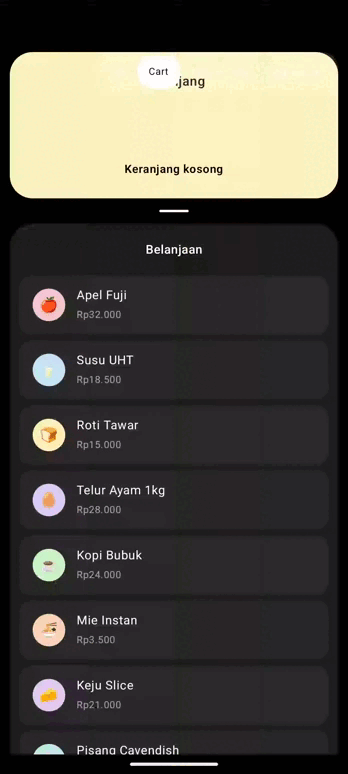
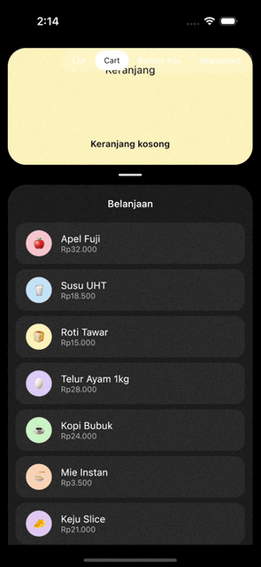

# Transfer: list item → card

=== "Android"
    

=== "iOS"
    

Wrap the screen in a `GooeyTransferHost`, mark each source row with `GooeySource`, and give the
target card a `GooeyTarget`. Tapping (or long-press-dragging) a source transfers its token.

```kotlin
val state = rememberGooeyTransferState()

GooeyTransferHost(state = state) {
    Column {
        GooeyTarget(state = state, cornerRadius = 28.dp) {
            TransferredTokens()
        }

        LazyColumn {
            items(friends, key = { it.id }) { friend ->
                GooeySource(
                    state = state,
                    key = friend.id,
                    color = friend.tint,
                    cornerRadius = 16.dp,
                    token = { Avatar(friend) },
                ) {
                    FriendRow(friend, avatarModifier = Modifier.tokenAnchor())
                }
            }
        }
    }
}
```

`tokenAnchor()` marks where inside the row the flying copy visually starts from.

## Pairing with a notch shape

Pair the target with a `GooeyNotchShape` to make the card's background open a matching notch as
tokens arrive:

```kotlin
val notchRadius by animateDpAsState(if (collapsed) 30.dp else 0.dp)

GooeyTarget(
    state = state,
    cornerRadius = 28.dp,
    notchRadius = notchRadius,
    modifier = Modifier.background(CardYellow, GooeyNotchShape(cornerRadius = 28.dp, notchRadius = notchRadius)),
) {
    TransferredTokens()
}
```
