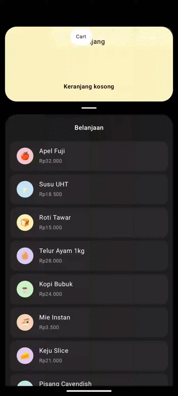
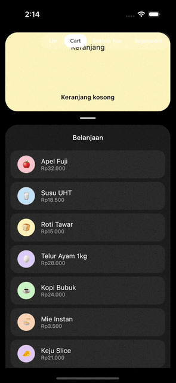

# Transfer: list item → card

=== "Android"
    

=== "iOS"
    

Wrap the screen in a `GooeyTransferHost`, mark each source row with `GooeySource`, and give the
target card a `GooeyTarget`. Tapping (or long-press-dragging) a source transfers its token into the
target, with a gooey bridge connecting the two while it travels.

## Quick start

```kotlin
val state = rememberGooeyTransferState()

GooeyTransferHost(state = state) {
    Column {
        GooeyTarget(state = state, cornerRadius = 28.dp) {
            TransferredTokens()
        }

        LazyColumn {
            items(friends, key = { it.id }) { friend ->
                GooeySource(
                    state = state,
                    key = friend.id,
                    color = friend.tint,
                    cornerRadius = 16.dp,
                    token = { Avatar(friend) },
                ) {
                    FriendRow(friend, avatarModifier = Modifier.tokenAnchor())
                }
            }
        }
    }
}
```

`tokenAnchor()` marks where inside the row the flying copy visually starts from.

Four moving parts, always used together:

1. `rememberGooeyTransferState()` — one state object per screen/host.
2. `GooeyTransferHost(state) { ... }` — draws the gooey overlay and in-flight tokens above
   everything inside it; sources and targets can live anywhere inside, including inside a
   `LazyColumn`.
3. `GooeySource(state, key, color, token) { content }` — a row/card whose `token` flies into the
   target when tapped (or dragged).
4. `GooeyTarget(state) { TransferredTokens() }` — the destination; `TransferredTokens()` renders
   the row of tokens that have arrived.

## How the state works

`GooeyTransferState` is a bit more involved than the nav indicator / segmented control states,
because it's coordinating *several* sources, one target, and (optionally) an in-progress drag —
but the underlying idea is the same: **the state only holds data and runs animations; your UI
decides when things happen.**

1. **`rememberGooeyTransferState()`** creates one `GooeyTransferState` shared by every `GooeySource`
   and the `GooeyTarget` inside the same `GooeyTransferHost`.
2. Every `GooeySource` **registers itself** with the state (keyed by the `key` you pass) as soon as
   it enters composition, and **unregisters** when it leaves — this is what makes it safe to put
   sources inside a `LazyColumn`: a row that's scrolled off-screen is simply not registered until
   it's recomposed again.
3. Tapping a source calls **`state.transfer(key)`** internally (bound to `.clickable` for you) —
   you don't normally call this yourself unless you're triggering a transfer from somewhere other
   than a tap, e.g. a button elsewhere on screen.
4. While a token is flying, it's tracked as a `TransferredItem` with its own progress animation.
   `GooeyTransferHost` reads every in-flight item's progress each frame to build the blob shapes
   (source blob, bridge, target blob) and to position the actual flying `token` composable on top.
5. Once progress reaches `1f`, the token "lands" — `GooeyTarget`'s `TransferredTokens()` then draws
   it as a resting token in its row.
6. **Dragging** (long-press and drag, enabled by default) runs a separate `DragSession`: the token
   follows your finger with a gooey "neck" stretching back to the source, and on release the state
   decides whether to commit the transfer or spring back, based on how close to the target you let
   go and how fast you were moving (`FlingVelocity`).

### State you can read and call yourself

| Member | What it does |
| --- | --- |
| `state.transfer(key)` | Starts (or resumes) moving a source's token into the target. Normally called for you by tapping a `GooeySource`. |
| `state.returnToSource(key)` | Animates a resting token back out of the target to its source, then removes it. Wired to tapping a token in `TransferredTokens()` when `removable = true` (the default). |
| `state.remove(key)` | Removes a token from the target instantly, with no animation — use this for things like "clear all" or restoring saved state without replaying the transfer. |
| `state.isTransferred(key)` | `true` once that key has landed in the target. Useful for dimming/disabling a source row (this already happens automatically — see below). |
| `state.transferredKeys` | The current target contents, newest first — read this to know what's "in the cart" right now. |
| `state.isAnimating` | `true` while anything (a drag or a flight) is in progress — handy to disable other interactions mid-animation. |

Note that `GooeySource` already dims itself (`transferredAlpha`) and disables its own tap/drag
once its key is transferred, using `state.isTransferred(key)` internally — you don't need to wire
that up by hand.

## Customizing the colors

Each `GooeySource` has its **own** `color` — this is what makes a per-item tint possible (e.g. one
color per friend, per product, per category), unlike the nav indicator/segmented control which
take one shared color for the whole host:

```kotlin
GooeySource(
    state = state,
    key = friend.id,
    color = friend.tint,       // any androidx.compose.ui.graphics.Color, per item
    cornerRadius = 16.dp,
    token = { Avatar(friend) },
) { FriendRow(friend, avatarModifier = Modifier.tokenAnchor()) }
```

Two more parameters control how color is used, both on `GooeyTransferHost`:

- `maxTintAlpha` (default `0.55f`) — how strongly the bridge/blob tints toward `color` at its most
  intense point mid-flight. Lower it for a more subtle, mostly-white bridge.
- On `GooeySource`, `transferredAlpha` (default `0.45f`) — the opacity the *source row* fades to
  once its token has been transferred, so it reads as "already added" without disappearing.

```kotlin
GooeyTransferHost(state = state, maxTintAlpha = 0.3f) { /* ... */ }
```

A per-item color is also simplest way to make sure the flying token and the row it came from read
as "the same object" — pick it from your data (as `friend.tint` does above) or from your theme,
e.g. `MaterialTheme.colorScheme.primary`.

## Changing the token / icon

`token` is a plain `@Composable () -> Unit` — there's no special "icon" API. It's used in two
places automatically: as the flying copy while in transit, and as the resting item inside
`TransferredTokens()`. Swap it for anything of a similar aspect ratio — an avatar, a product
thumbnail, an emoji, or a Material icon:

```kotlin
import androidx.compose.material.icons.Icons
import androidx.compose.material.icons.filled.Star
import androidx.compose.material3.Icon

GooeySource(
    state = state,
    key = product.id,
    color = product.tint,
    token = {
        Icon(
            imageVector = Icons.Filled.Star,
            contentDescription = product.name,
            tint = Color.Black,
        )
    },
) { ProductRow(product) }
```

Reactify doesn't ship icons itself — add
`org.jetbrains.compose.material:material-icons-extended` (Compose Multiplatform) or
`androidx.compose.material:material-icons-extended` (Android-only) to your own app module if you
want Material icons instead of emoji/avatars.

Two details that matter when swapping `token`:

- Whatever you put in `token` is measured at the **source row's** size the first time it's drawn,
  then scaled as it flies — so keep it roughly square (like an avatar or icon) rather than a wide
  piece of text, or it will stretch oddly mid-flight.
- `Modifier.tokenAnchor()`, applied inside the source's `content`, marks exactly where the flying
  copy visually starts from (e.g. right on top of a small avatar inside a bigger row) — omit it and
  the whole row's bounds are used as the starting point instead.

`TransferredTokens()` itself (called inside `GooeyTarget`) takes its own styling parameters:

```kotlin
TransferredTokens(
    tokenSize = 32.dp,   // size each resting token is drawn at
    spacing = 6.dp,      // gap between resting tokens
    removable = true,    // tap a resting token to send it back to its source
)
```

## Pairing with a notch shape

Pair the target with a `GooeyNotchShape` to make the card's background open a matching notch as
tokens arrive — this is what makes the card look like it's "swallowing" the token:

```kotlin
val notchRadius by animateDpAsState(if (collapsed) 30.dp else 0.dp)

GooeyTarget(
    state = state,
    cornerRadius = 28.dp,
    notchRadius = notchRadius,
    modifier = Modifier.background(CardYellow, GooeyNotchShape(cornerRadius = 28.dp, notchRadius = notchRadius)),
) {
    TransferredTokens()
}
```

`notchRadius` must be passed to **both** places — `GooeyTarget` (so the gooey overlay bends around
the notch) and `GooeyNotchShape` (so the background actually has a matching concave cutout) — and
`cornerRadius` must match between them too. Animate `notchRadius` yourself (as above, with
`animateDpAsState` or a `spring`); the shape and overlay just follow whatever value you give them.

## Tap vs. drag

Both are enabled by default on every `GooeySource`:

- **Tap** always transfers the token immediately.
- **Long-press, then drag** picks the token up and follows your finger, stretching a gooey neck
  back to the source; releasing it near the target (or flinging it towards the target fast enough)
  commits the transfer, otherwise it springs back. The long-press requirement keeps this from
  fighting with scrolling in a `LazyColumn`.

Disable drag (keep tap-to-transfer only) with `dragEnabled = false`, or disable both interactions
with `enabled = false` (e.g. while something else is loading).

## Parameters reference

**`rememberGooeyTransferState`**

| Parameter | Default | Description |
| --- | --- | --- |
| `animationSpec` | `tween(1100ms, LinearEasing)` | Drives the master flight progress (0→1). Keep it linear — the grow/stretch/pinch shape itself is already baked into the choreography, not into easing. |

**`GooeyTransferHost`**

| Parameter | Default | Description |
| --- | --- | --- |
| `state` | — | The shared `GooeyTransferState`. |
| `renderer` | `GooeyRenderers.auto()` | See [Choosing a Renderer](renderers.md). |
| `smoothness` | `24.dp` | How far the gooey blend reaches around the bridge/blobs. |
| `maxTintAlpha` | `0.55f` | Maximum tint intensity of the bridge/blob toward the source's `color`. |

**`GooeySource`**

| Parameter | Default | Description |
| --- | --- | --- |
| `key` | — | Identifies this source; must be stable and unique (e.g. an id), same idea as `LazyColumn`'s `key`. |
| `color` | — | Tint for this source's gooey overlay. |
| `token` | — | The flying/resting content — see "Changing the token / icon" above. |
| `cornerRadius` | `16.dp` | Must match the visual corner radius of `content`'s background, or the blob won't line up with the row. |
| `enabled` | `true` | Disables both tap and drag when `false`. |
| `dragEnabled` | `true` | Disables long-press-drag while keeping tap-to-transfer. |
| `transferredAlpha` | `0.45f` | Opacity the row fades to once transferred. |

**`GooeyTarget`**

| Parameter | Default | Description |
| --- | --- | --- |
| `cornerRadius` | `16.dp` | Must match the visual corner radius of `content`'s background. |
| `notchRadius` | `0.dp` | Current radius of a paired `GooeyNotchShape` notch, if any — see "Pairing with a notch shape". |

## Tips & troubleshooting

!!! tip "Tokens don't fly anywhere"
    `GooeyTransferHost` must be an ancestor of both the `GooeySource`s and the `GooeyTarget` — it's
    the thing that actually draws the overlay. A `GooeySource` or `GooeyTarget` outside the host has
    nowhere to render into.

!!! tip "The flying token is squashed or stretched oddly"
    Give `token` a roughly square aspect ratio, and double-check `cornerRadius` on `GooeySource` /
    `GooeyTarget` matches the real corner radius of your row/card backgrounds — a mismatch here is
    the most common cause of the blob looking visually "off" from the content underneath it.

!!! tip "A transfer started before a row scrolled off-screen looks wrong when it lands"
    This is expected to self-correct: in-flight transfers re-read the source's live bounds each
    frame, so they follow the row while it's still composed; once it scrolls away, the last known
    bounds are used for the rest of the flight, and landing always targets the target's current
    bounds, which doesn't move.
